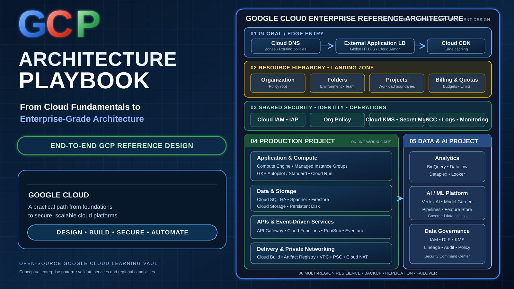
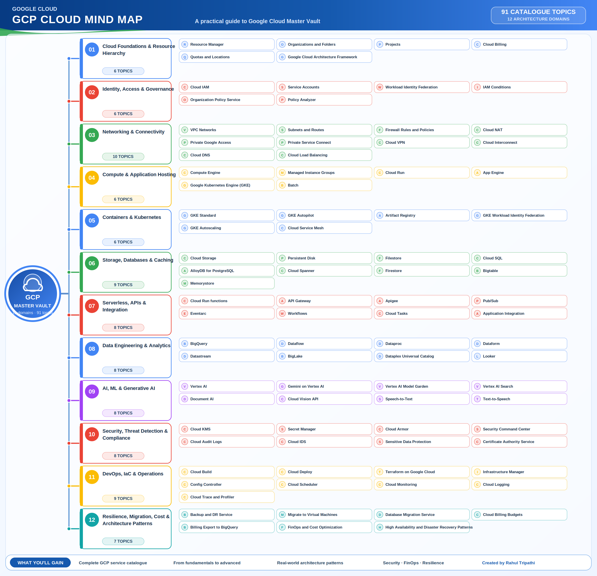
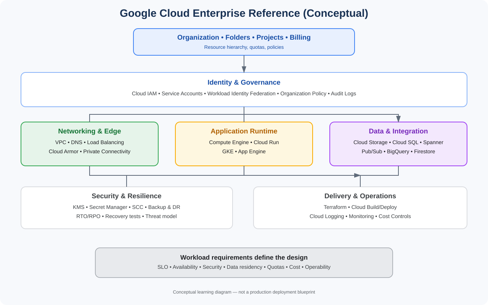

# Cloud Architecture Playbook

> **Google Cloud Edition** — From Cloud Fundamentals to Enterprise-Grade Architecture. An open-source Solution Architect learning portal with service guides, reference architecture, diagrams and hands-on implementation projects.

## Start here

## GCP component catalogue mind map

The GCP Master Vault mind map organizes the full catalogue into **12 architecture domains and 91 learning topics**. The PNG is the quick visual overview; the SVG is scalable, and the diagrams.net file is editable.

  

- [Open the GCP mind map (PNG)](assets/GCP-CLOUD-MINDMAP.png)
- [Open the scalable mind map (SVG)](assets/GCP-CLOUD-MINDMAP.svg)
- [Edit the mind map in diagrams.net (draw.io)](GCP-CLOUD-MINDMAP.drawio)

| 
📚 Integrated learning tracker
 | 
🏗️ End-to-end design
 | 
🗺️ Diagram library
 |
|---|---|---|
| Mark topics complete and follow progress across all 12 domains in one interactive page. | Explore how organization, identity, networking, workloads, data, security and operations fit together. | Explore the GCP mind map, category diagrams and editable draw.io sources. |
| [**Open learning tracker →**](https://tripathies.github.io/GCP-Master-Vault/) | [**Open reference design →**](GCP-ENTERPRISE-REFERENCE-ARCHITECTURE.md) | [**Open visual library →**](VISUAL-DIAGRAMS.md) |

## Your GCP learning tracker

Use the [interactive GCP learning catalogue](https://tripathies.github.io/GCP-Master-Vault/) to record topic completion and monitor the live overall progress bar and all 12 domain milestones. The progress board and the 91 topic checkboxes sit together on the same page; completing every topic in a domain marks that milestone complete.

**Catalogue size:** 91 service/topic guides across 12 categories. Progress is saved in the current browser; export a backup to transfer it to another device. The expandable checklists in this README remain a static reference and retain all topic guide links.

### Browse categories

| Domain | Category | Topics | Tracker |
|---|---|---:|---|
| **01** | [Cloud Foundations & Resource Hierarchy](buckets/01-cloud-foundations/README.md) | 6 | [Open milestone](https://tripathies.github.io/GCP-Master-Vault/#category-01) |
| **02** | [Identity, Access & Governance](buckets/02-identity-governance/README.md) | 6 | [Open milestone](https://tripathies.github.io/GCP-Master-Vault/#category-02) |
| **03** | [Networking & Connectivity](buckets/03-networking/README.md) | 10 | [Open milestone](https://tripathies.github.io/GCP-Master-Vault/#category-03) |
| **04** | [Compute & Application Hosting](buckets/04-compute-app-hosting/README.md) | 6 | [Open milestone](https://tripathies.github.io/GCP-Master-Vault/#category-04) |
| **05** | [Containers & Kubernetes](buckets/05-containers-kubernetes/README.md) | 6 | [Open milestone](https://tripathies.github.io/GCP-Master-Vault/#category-05) |
| **06** | [Storage, Databases & Caching](buckets/06-storage-databases/README.md) | 9 | [Open milestone](https://tripathies.github.io/GCP-Master-Vault/#category-06) |
| **07** | [Serverless, APIs & Integration](buckets/07-serverless-integration/README.md) | 8 | [Open milestone](https://tripathies.github.io/GCP-Master-Vault/#category-07) |
| **08** | [Data Engineering & Analytics](buckets/08-data-analytics/README.md) | 8 | [Open milestone](https://tripathies.github.io/GCP-Master-Vault/#category-08) |
| **09** | [AI, ML & Generative AI](buckets/09-ai-ml-genai/README.md) | 8 | [Open milestone](https://tripathies.github.io/GCP-Master-Vault/#category-09) |
| **10** | [Security, Threat Detection & Compliance](buckets/10-security-compliance/README.md) | 8 | [Open milestone](https://tripathies.github.io/GCP-Master-Vault/#category-10) |
| **11** | [DevOps, IaC & Operations](buckets/11-devops-iac-operations/README.md) | 9 | [Open milestone](https://tripathies.github.io/GCP-Master-Vault/#category-11) |
| **12** | [Resilience, Migration, Cost & Architecture Patterns](buckets/12-resilience-migration-cost/README.md) | 7 | [Open milestone](https://tripathies.github.io/GCP-Master-Vault/#category-12) |

### Component checklist

<strong>01. Cloud Foundations & Resource Hierarchy</strong>

[Open category learning guide](buckets/01-cloud-foundations/README.md)

- [ ] [Resource Manager](services/resource-manager.md)
- [ ] [Organizations and Folders](services/organizations-and-folders.md)
- [ ] [Projects](services/projects.md)
- [ ] [Cloud Billing](services/cloud-billing.md)
- [ ] [Quotas and Locations](services/quotas-and-locations.md)
- [ ] [Google Cloud Architecture Framework](services/google-cloud-architecture-framework.md)

<strong>02. Identity, Access & Governance</strong>

[Open category learning guide](buckets/02-identity-governance/README.md)

- [ ] [Cloud IAM](services/cloud-iam.md)
- [ ] [Service Accounts](services/service-accounts.md)
- [ ] [Workload Identity Federation](services/workload-identity-federation.md)
- [ ] [IAM Conditions](services/iam-conditions.md)
- [ ] [Organization Policy Service](services/organization-policy-service.md)
- [ ] [Policy Analyzer](services/policy-analyzer.md)

<strong>03. Networking & Connectivity</strong>

[Open category learning guide](buckets/03-networking/README.md)

- [ ] [VPC Networks](services/vpc-networks.md)
- [ ] [Subnets and Routes](services/subnets-and-routes.md)
- [ ] [Firewall Rules and Policies](services/firewall-rules-and-policies.md)
- [ ] [Cloud NAT](services/cloud-nat.md)
- [ ] [Private Google Access](services/private-google-access.md)
- [ ] [Private Service Connect](services/private-service-connect.md)
- [ ] [Cloud VPN](services/cloud-vpn.md)
- [ ] [Cloud Interconnect](services/cloud-interconnect.md)
- [ ] [Cloud DNS](services/cloud-dns.md)
- [ ] [Cloud Load Balancing](services/cloud-load-balancing.md)

<strong>04. Compute & Application Hosting</strong>

[Open category learning guide](buckets/04-compute-app-hosting/README.md)

- [ ] [Compute Engine](services/compute-engine.md)
- [ ] [Managed Instance Groups](services/managed-instance-groups.md)
- [ ] [Cloud Run](services/cloud-run.md)
- [ ] [App Engine](services/app-engine.md)
- [ ] [Google Kubernetes Engine (GKE)](services/gke.md)
- [ ] [Batch](services/batch.md)

<strong>05. Containers & Kubernetes</strong>

[Open category learning guide](buckets/05-containers-kubernetes/README.md)

- [ ] [GKE Standard](services/gke-standard.md)
- [ ] [GKE Autopilot](services/gke-autopilot.md)
- [ ] [Artifact Registry](services/artifact-registry.md)
- [ ] [GKE Workload Identity Federation](services/gke-workload-identity-federation.md)
- [ ] [GKE Autoscaling](services/gke-autoscaling.md)
- [ ] [Cloud Service Mesh](services/cloud-service-mesh.md)

<strong>06. Storage, Databases & Caching</strong>

[Open category learning guide](buckets/06-storage-databases/README.md)

- [ ] [Cloud Storage](services/cloud-storage.md)
- [ ] [Persistent Disk](services/persistent-disk.md)
- [ ] [Filestore](services/filestore.md)
- [ ] [Cloud SQL](services/cloud-sql.md)
- [ ] [AlloyDB for PostgreSQL](services/alloydb-for-postgresql.md)
- [ ] [Cloud Spanner](services/cloud-spanner.md)
- [ ] [Firestore](services/firestore.md)
- [ ] [Bigtable](services/bigtable.md)
- [ ] [Memorystore](services/memorystore.md)

<strong>07. Serverless, APIs & Integration</strong>

[Open category learning guide](buckets/07-serverless-integration/README.md)

- [ ] [Cloud Run functions](services/cloud-run-functions.md)
- [ ] [API Gateway](services/api-gateway.md)
- [ ] [Apigee](services/apigee.md)
- [ ] [Pub/Sub](services/pub-sub.md)
- [ ] [Eventarc](services/eventarc.md)
- [ ] [Workflows](services/workflows.md)
- [ ] [Cloud Tasks](services/cloud-tasks.md)
- [ ] [Application Integration](services/application-integration.md)

<strong>08. Data Engineering & Analytics</strong>

[Open category learning guide](buckets/08-data-analytics/README.md)

- [ ] [BigQuery](services/bigquery.md)
- [ ] [Dataflow](services/dataflow.md)
- [ ] [Dataproc](services/dataproc.md)
- [ ] [Dataform](services/dataform.md)
- [ ] [Datastream](services/datastream.md)
- [ ] [BigLake](services/biglake.md)
- [ ] [Dataplex Universal Catalog](services/dataplex-universal-catalog.md)
- [ ] [Looker](services/looker.md)

<strong>09. AI, ML & Generative AI</strong>

[Open category learning guide](buckets/09-ai-ml-genai/README.md)

- [ ] [Vertex AI](services/vertex-ai.md)
- [ ] [Gemini on Vertex AI](services/gemini-on-vertex-ai.md)
- [ ] [Vertex AI Model Garden](services/vertex-ai-model-garden.md)
- [ ] [Vertex AI Search](services/vertex-ai-search.md)
- [ ] [Document AI](services/document-ai.md)
- [ ] [Cloud Vision API](services/cloud-vision-api.md)
- [ ] [Speech-to-Text](services/speech-to-text.md)
- [ ] [Text-to-Speech](services/text-to-speech.md)

<strong>10. Security, Threat Detection & Compliance</strong>

[Open category learning guide](buckets/10-security-compliance/README.md)

- [ ] [Cloud KMS](services/cloud-kms.md)
- [ ] [Secret Manager](services/secret-manager.md)
- [ ] [Cloud Armor](services/cloud-armor.md)
- [ ] [Security Command Center](services/security-command-center.md)
- [ ] [Cloud Audit Logs](services/cloud-audit-logs.md)
- [ ] [Cloud IDS](services/cloud-ids.md)
- [ ] [Sensitive Data Protection](services/sensitive-data-protection.md)
- [ ] [Certificate Authority Service](services/certificate-authority-service.md)

<strong>11. DevOps, IaC & Operations</strong>

[Open category learning guide](buckets/11-devops-iac-operations/README.md)

- [ ] [Cloud Build](services/cloud-build.md)
- [ ] [Cloud Deploy](services/cloud-deploy.md)
- [ ] [Terraform on Google Cloud](services/terraform-on-google-cloud.md)
- [ ] [Infrastructure Manager](services/infrastructure-manager.md)
- [ ] [Config Controller](services/config-controller.md)
- [ ] [Cloud Scheduler](services/cloud-scheduler.md)
- [ ] [Cloud Monitoring](services/cloud-monitoring.md)
- [ ] [Cloud Logging](services/cloud-logging.md)
- [ ] [Cloud Trace and Profiler](services/cloud-trace-and-profiler.md)

<strong>12. Resilience, Migration, Cost & Architecture Patterns</strong>

[Open category learning guide](buckets/12-resilience-migration-cost/README.md)

- [ ] [Backup and DR Service](services/backup-and-dr-service.md)
- [ ] [Migrate to Virtual Machines](services/migrate-to-virtual-machines.md)
- [ ] [Database Migration Service](services/database-migration-service.md)
- [ ] [Cloud Billing Budgets](services/cloud-billing-budgets.md)
- [ ] [Billing Export to BigQuery](services/billing-export-to-bigquery.md)
- [ ] [FinOps and Cost Optimization](services/finops-and-cost-optimization.md)
- [ ] [High Availability and Disaster Recovery Patterns](services/high-availability-and-disaster-recovery-patterns.md)

## Portfolio checkpoints
- [ ] Three-tier application: HTTPS load balancing + Compute Engine + Cloud SQL.
- [ ] Serverless API: API Gateway + Cloud Run + Firestore.
- [ ] Container platform: GKE + Artifact Registry.
- [ ] Event-driven pipeline: Cloud Storage + Pub/Sub + Eventarc.
- [ ] Analytics pipeline: Cloud Storage + Dataflow + BigQuery.
- [ ] Terraform-governed multi-project environment with least privilege.
- [ ] Vertex AI application with controlled access and observability.

## Lab evidence template
For each lab record the goal, architecture, prerequisites, identity model, deploy steps, validation, a failure test, actual cost observations, cleanup proof and lessons learned.

## Safety reminders
- Use a dedicated sandbox project where possible and set budgets/alerts. Budget notifications are not hard spending caps.
- Never commit credentials, service-account keys, secrets or production data.
- Prefer least privilege and workload identity patterns.
- Plan teardown before deployment and verify billable resources are removed.

## Official starting points
- [Google Cloud documentation](https://cloud.google.com/docs)
- [Google Cloud Architecture Framework](https://cloud.google.com/architecture/framework)
- [Google Cloud Skills Boost](https://www.cloudskillsboost.google/)
- [Google Cloud pricing](https://cloud.google.com/pricing)

## Licensing and permitted use

This vault is provided for personal learning, research, and other permitted noncommercial purposes.

- Original documentation, learning notes, explanations, and diagrams: [CC BY-NC 4.0](LICENSE-DOCS.md).
- Code, scripts, automation, templates, configuration, and infrastructure-as-code: [PolyForm Noncommercial 1.0.0](LICENSE-CODE.md).
- **Commercial or business use is not permitted without prior written permission.** This includes use in business/organisational operations, paid training or consulting deliverables, commercial resale or redistribution, commercial hosting/managed services, and incorporation into commercial products or services.
- Third-party provider documentation, trademarks, screenshots, excerpts, logos, icons, fonts, images, dependencies, and SDKs are excluded and remain subject to their original terms.

This is source-available, not OSI-approved open source. See the licence files for the full terms and scope.
