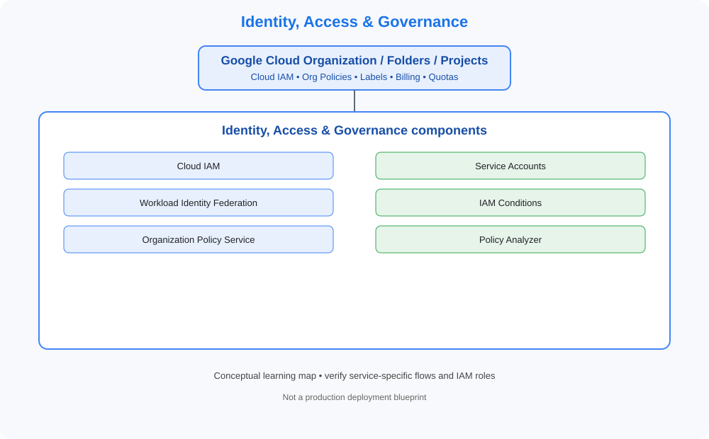

# 02. Identity, Access & Governance

> GCP Master Vault learning tracker. This category uses GCP-native services, identity models, networking and governance terminology.

## Category architecture

- [Editable category diagram](architecture.drawio)
- [Mermaid source](architecture.mmd)
- [Visual architecture library](../../VISUAL-DIAGRAMS.md)
- [Enterprise reference architecture](../../GCP-ENTERPRISE-REFERENCE-ARCHITECTURE.md)

## Component checklist

| Topic | Learning guide | Diagram (SVG) | Editable diagram |
|---|---|---|---|
| Cloud IAM | [Open guide](../../services/cloud-iam.md) | [View](../../services/cloud-iam/architecture.svg) | [draw.io](../../services/cloud-iam/architecture.drawio) |
| Service Accounts | [Open guide](../../services/service-accounts.md) | [View](../../services/service-accounts/architecture.svg) | [draw.io](../../services/service-accounts/architecture.drawio) |
| Workload Identity Federation | [Open guide](../../services/workload-identity-federation.md) | [View](../../services/workload-identity-federation/architecture.svg) | [draw.io](../../services/workload-identity-federation/architecture.drawio) |
| IAM Conditions | [Open guide](../../services/iam-conditions.md) | [View](../../services/iam-conditions/architecture.svg) | [draw.io](../../services/iam-conditions/architecture.drawio) |
| Organization Policy Service | [Open guide](../../services/organization-policy-service.md) | [View](../../services/organization-policy-service/architecture.svg) | [draw.io](../../services/organization-policy-service/architecture.drawio) |
| Policy Analyzer | [Open guide](../../services/policy-analyzer.md) | [View](../../services/policy-analyzer/architecture.svg) | [draw.io](../../services/policy-analyzer/architecture.drawio) |

## Practice workflow
1. Read the official documentation and note service scope, limits and alternatives.
2. Map identity, network paths, data flows, dependencies and ownership.
3. Complete a sandbox lab and capture validation evidence.
4. Test an access-denied or failure scenario where safe.
5. Record monitoring, cost observations and teardown proof.

## Official references
- [GCP documentation](https://cloud.google.com/docs)
- [Architecture framework](https://cloud.google.com/architecture/framework)
- [Pricing](https://cloud.google.com/pricing/)

> Diagrams are conceptual learning resources, not production-certified designs. Verify service capabilities, IAM permissions, network behavior, quotas, regional availability and pricing before deployment.
