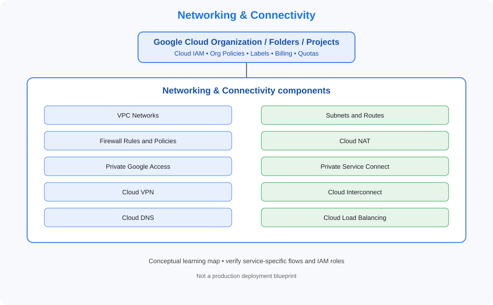

# 03. Networking & Connectivity

> GCP Master Vault learning tracker. This category uses GCP-native services, identity models, networking and governance terminology.

## Category architecture

- [Editable category diagram](architecture.drawio)
- [Mermaid source](architecture.mmd)
- [Visual architecture library](../../VISUAL-DIAGRAMS.md)
- [Enterprise reference architecture](../../GCP-ENTERPRISE-REFERENCE-ARCHITECTURE.md)

## Component checklist

| Topic | Learning guide | Diagram (SVG) | Editable diagram |
|---|---|---|---|
| VPC Networks | [Open guide](../../services/vpc-networks.md) | [View](../../services/vpc-networks/architecture.svg) | [draw.io](../../services/vpc-networks/architecture.drawio) |
| Subnets and Routes | [Open guide](../../services/subnets-and-routes.md) | [View](../../services/subnets-and-routes/architecture.svg) | [draw.io](../../services/subnets-and-routes/architecture.drawio) |
| Firewall Rules and Policies | [Open guide](../../services/firewall-rules-and-policies.md) | [View](../../services/firewall-rules-and-policies/architecture.svg) | [draw.io](../../services/firewall-rules-and-policies/architecture.drawio) |
| Cloud NAT | [Open guide](../../services/cloud-nat.md) | [View](../../services/cloud-nat/architecture.svg) | [draw.io](../../services/cloud-nat/architecture.drawio) |
| Private Google Access | [Open guide](../../services/private-google-access.md) | [View](../../services/private-google-access/architecture.svg) | [draw.io](../../services/private-google-access/architecture.drawio) |
| Private Service Connect | [Open guide](../../services/private-service-connect.md) | [View](../../services/private-service-connect/architecture.svg) | [draw.io](../../services/private-service-connect/architecture.drawio) |
| Cloud VPN | [Open guide](../../services/cloud-vpn.md) | [View](../../services/cloud-vpn/architecture.svg) | [draw.io](../../services/cloud-vpn/architecture.drawio) |
| Cloud Interconnect | [Open guide](../../services/cloud-interconnect.md) | [View](../../services/cloud-interconnect/architecture.svg) | [draw.io](../../services/cloud-interconnect/architecture.drawio) |
| Cloud DNS | [Open guide](../../services/cloud-dns.md) | [View](../../services/cloud-dns/architecture.svg) | [draw.io](../../services/cloud-dns/architecture.drawio) |
| Cloud Load Balancing | [Open guide](../../services/cloud-load-balancing.md) | [View](../../services/cloud-load-balancing/architecture.svg) | [draw.io](../../services/cloud-load-balancing/architecture.drawio) |

## Practice workflow
1. Read the official documentation and note service scope, limits and alternatives.
2. Map identity, network paths, data flows, dependencies and ownership.
3. Complete a sandbox lab and capture validation evidence.
4. Test an access-denied or failure scenario where safe.
5. Record monitoring, cost observations and teardown proof.

## Official references
- [GCP documentation](https://cloud.google.com/docs)
- [Architecture framework](https://cloud.google.com/architecture/framework)
- [Pricing](https://cloud.google.com/pricing/)

> Diagrams are conceptual learning resources, not production-certified designs. Verify service capabilities, IAM permissions, network behavior, quotas, regional availability and pricing before deployment.
