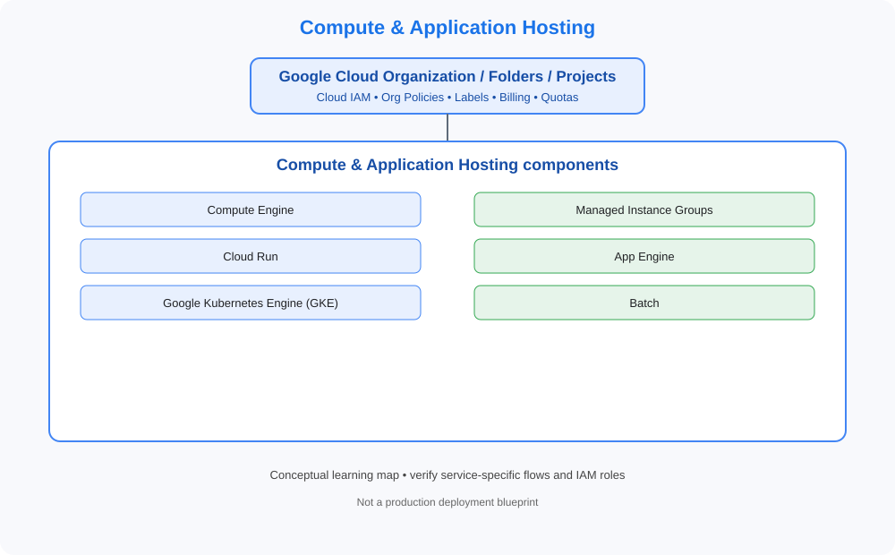

# Compute & Application Hosting

> Category learning tracker for GCP Master Vault. Service names and examples in this folder are GCP-specific.

## Category architecture

- [Editable category diagram](architecture.drawio)
- [Mermaid source](architecture.mmd)
- [Full visual library](../../VISUAL-DIAGRAMS.md)
- [Master architecture](../../GCP-ENTERPRISE-REFERENCE-ARCHITECTURE.md)

## Component tracker

| Topic guide | SVG diagram | Editable draw.io |
|---|---|---|
| [Compute Engine](../../services/compute-engine.md) | [SVG](../../services/compute-engine/architecture.svg) | [draw.io](../../services/compute-engine/architecture.drawio) |
| [Managed Instance Groups](../../services/managed-instance-groups.md) | [SVG](../../services/managed-instance-groups/architecture.svg) | [draw.io](../../services/managed-instance-groups/architecture.drawio) |
| [Cloud Run](../../services/cloud-run.md) | [SVG](../../services/cloud-run/architecture.svg) | [draw.io](../../services/cloud-run/architecture.drawio) |
| [App Engine](../../services/app-engine.md) | [SVG](../../services/app-engine/architecture.svg) | [draw.io](../../services/app-engine/architecture.drawio) |
| [Google Kubernetes Engine (GKE)](../../services/google-kubernetes-engine-gke.md) | [SVG](../../services/google-kubernetes-engine-gke/architecture.svg) | [draw.io](../../services/google-kubernetes-engine-gke/architecture.drawio) |
| [Batch](../../services/batch.md) | [SVG](../../services/batch/architecture.svg) | [draw.io](../../services/batch/architecture.drawio) |

## Practice workflow
1. Read the official documentation for each selected service.
2. Map its account/project boundary, identity, network and data flows.
3. Complete a sandbox lab and capture validation evidence.
4. Test one denied-access or failure scenario.
5. Record cost, teardown proof and design trade-offs.

## Official references
- [Google Cloud documentation](https://cloud.google.com/docs)
- [Google Cloud Architecture Framework](https://cloud.google.com/architecture/framework)
- [Google Cloud pricing](https://cloud.google.com/pricing)

> Diagram files are conceptual learning resources, not production-certified designs. Validate current service capabilities, permissions, routing, quotas, regional availability and prices before deployment.
