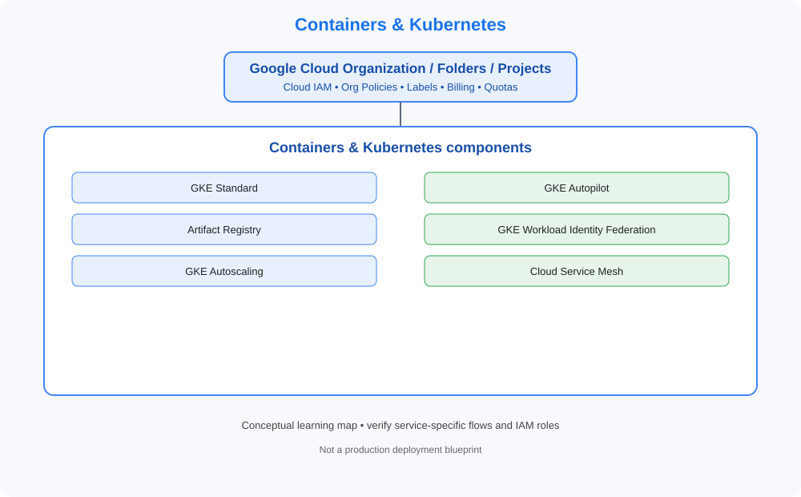

# Containers & Kubernetes

> Category learning tracker for GCP Master Vault. Service names and examples in this folder are GCP-specific.

## Category architecture

- [Editable category diagram](architecture.drawio)
- [Mermaid source](architecture.mmd)
- [Full visual library](../../VISUAL-DIAGRAMS.md)
- [Master architecture](../../GCP-ENTERPRISE-REFERENCE-ARCHITECTURE.md)

## Component tracker

| Topic guide | SVG diagram | Editable draw.io |
|---|---|---|
| [GKE Standard](../../services/gke-standard.md) | [SVG](../../services/gke-standard/architecture.svg) | [draw.io](../../services/gke-standard/architecture.drawio) |
| [GKE Autopilot](../../services/gke-autopilot.md) | [SVG](../../services/gke-autopilot/architecture.svg) | [draw.io](../../services/gke-autopilot/architecture.drawio) |
| [Artifact Registry](../../services/artifact-registry.md) | [SVG](../../services/artifact-registry/architecture.svg) | [draw.io](../../services/artifact-registry/architecture.drawio) |
| [GKE Workload Identity Federation](../../services/gke-workload-identity-federation.md) | [SVG](../../services/gke-workload-identity-federation/architecture.svg) | [draw.io](../../services/gke-workload-identity-federation/architecture.drawio) |
| [GKE Autoscaling](../../services/gke-autoscaling.md) | [SVG](../../services/gke-autoscaling/architecture.svg) | [draw.io](../../services/gke-autoscaling/architecture.drawio) |
| [Cloud Service Mesh](../../services/cloud-service-mesh.md) | [SVG](../../services/cloud-service-mesh/architecture.svg) | [draw.io](../../services/cloud-service-mesh/architecture.drawio) |

## Practice workflow
1. Read the official documentation for each selected service.
2. Map its account/project boundary, identity, network and data flows.
3. Complete a sandbox lab and capture validation evidence.
4. Test one denied-access or failure scenario.
5. Record cost, teardown proof and design trade-offs.

## Official references
- [Google Cloud documentation](https://cloud.google.com/docs)
- [Google Cloud Architecture Framework](https://cloud.google.com/architecture/framework)
- [Google Cloud pricing](https://cloud.google.com/pricing)

> Diagram files are conceptual learning resources, not production-certified designs. Validate current service capabilities, permissions, routing, quotas, regional availability and prices before deployment.
