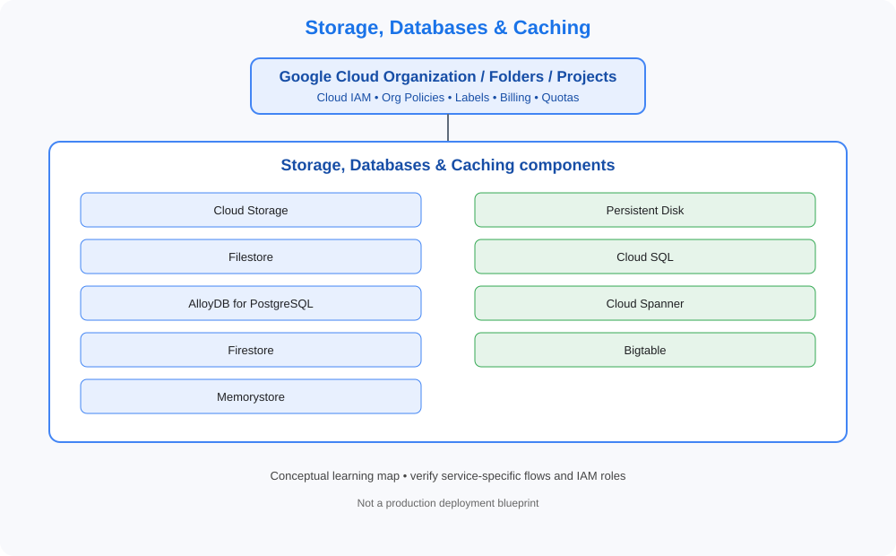

# 06. Storage, Databases & Caching

> GCP Master Vault learning tracker. This category uses GCP-native services, identity models, networking and governance terminology.

## Category architecture

- [Editable category diagram](architecture.drawio)
- [Mermaid source](architecture.mmd)
- [Visual architecture library](../../VISUAL-DIAGRAMS.md)
- [Enterprise reference architecture](../../GCP-ENTERPRISE-REFERENCE-ARCHITECTURE.md)

## Component checklist

| Topic | Learning guide | Diagram (SVG) | Editable diagram |
|---|---|---|---|
| Cloud Storage | [Open guide](../../services/cloud-storage.md) | [View](../../services/cloud-storage/architecture.svg) | [draw.io](../../services/cloud-storage/architecture.drawio) |
| Persistent Disk | [Open guide](../../services/persistent-disk.md) | [View](../../services/persistent-disk/architecture.svg) | [draw.io](../../services/persistent-disk/architecture.drawio) |
| Filestore | [Open guide](../../services/filestore.md) | [View](../../services/filestore/architecture.svg) | [draw.io](../../services/filestore/architecture.drawio) |
| Cloud SQL | [Open guide](../../services/cloud-sql.md) | [View](../../services/cloud-sql/architecture.svg) | [draw.io](../../services/cloud-sql/architecture.drawio) |
| AlloyDB for PostgreSQL | [Open guide](../../services/alloydb-for-postgresql.md) | [View](../../services/alloydb-for-postgresql/architecture.svg) | [draw.io](../../services/alloydb-for-postgresql/architecture.drawio) |
| Cloud Spanner | [Open guide](../../services/cloud-spanner.md) | [View](../../services/cloud-spanner/architecture.svg) | [draw.io](../../services/cloud-spanner/architecture.drawio) |
| Firestore | [Open guide](../../services/firestore.md) | [View](../../services/firestore/architecture.svg) | [draw.io](../../services/firestore/architecture.drawio) |
| Bigtable | [Open guide](../../services/bigtable.md) | [View](../../services/bigtable/architecture.svg) | [draw.io](../../services/bigtable/architecture.drawio) |
| Memorystore | [Open guide](../../services/memorystore.md) | [View](../../services/memorystore/architecture.svg) | [draw.io](../../services/memorystore/architecture.drawio) |

## Practice workflow
1. Read the official documentation and note service scope, limits and alternatives.
2. Map identity, network paths, data flows, dependencies and ownership.
3. Complete a sandbox lab and capture validation evidence.
4. Test an access-denied or failure scenario where safe.
5. Record monitoring, cost observations and teardown proof.

## Official references
- [GCP documentation](https://cloud.google.com/docs)
- [Architecture framework](https://cloud.google.com/architecture/framework)
- [Pricing](https://cloud.google.com/pricing/)

> Diagrams are conceptual learning resources, not production-certified designs. Verify service capabilities, IAM permissions, network behavior, quotas, regional availability and pricing before deployment.
