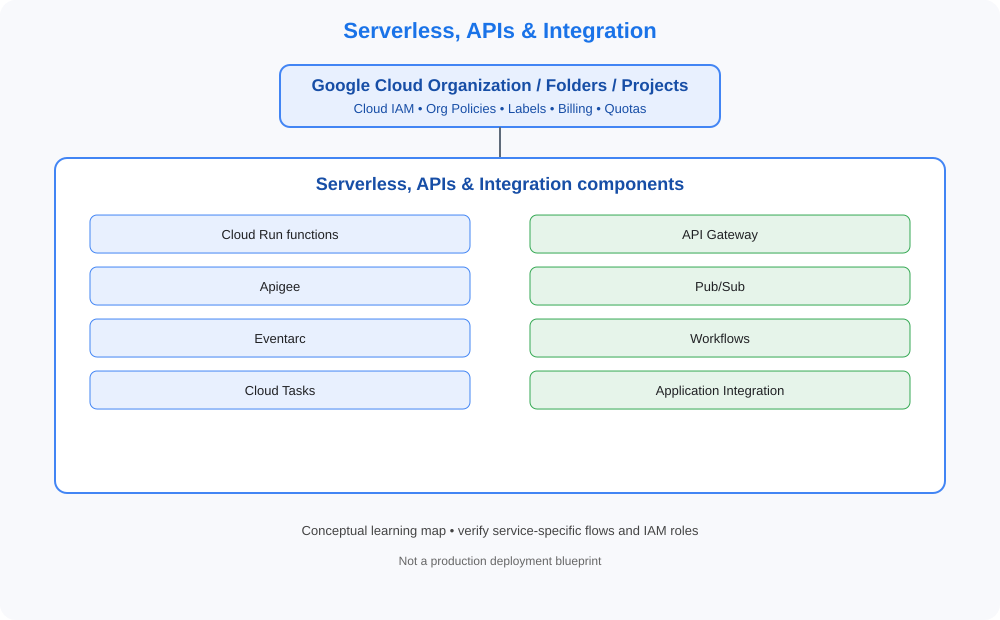

# 07. Serverless, APIs & Integration

> GCP Master Vault learning tracker. This category uses GCP-native services, identity models, networking and governance terminology.

## Category architecture

- [Editable category diagram](architecture.drawio)
- [Mermaid source](architecture.mmd)
- [Visual architecture library](../../VISUAL-DIAGRAMS.md)
- [Enterprise reference architecture](../../GCP-ENTERPRISE-REFERENCE-ARCHITECTURE.md)

## Component checklist

| Topic | Learning guide | Diagram (SVG) | Editable diagram |
|---|---|---|---|
| Cloud Run functions | [Open guide](../../services/cloud-run-functions.md) | [View](../../services/cloud-run-functions/architecture.svg) | [draw.io](../../services/cloud-run-functions/architecture.drawio) |
| API Gateway | [Open guide](../../services/api-gateway.md) | [View](../../services/api-gateway/architecture.svg) | [draw.io](../../services/api-gateway/architecture.drawio) |
| Apigee | [Open guide](../../services/apigee.md) | [View](../../services/apigee/architecture.svg) | [draw.io](../../services/apigee/architecture.drawio) |
| Pub/Sub | [Open guide](../../services/pub-sub.md) | [View](../../services/pub-sub/architecture.svg) | [draw.io](../../services/pub-sub/architecture.drawio) |
| Eventarc | [Open guide](../../services/eventarc.md) | [View](../../services/eventarc/architecture.svg) | [draw.io](../../services/eventarc/architecture.drawio) |
| Workflows | [Open guide](../../services/workflows.md) | [View](../../services/workflows/architecture.svg) | [draw.io](../../services/workflows/architecture.drawio) |
| Cloud Tasks | [Open guide](../../services/cloud-tasks.md) | [View](../../services/cloud-tasks/architecture.svg) | [draw.io](../../services/cloud-tasks/architecture.drawio) |
| Application Integration | [Open guide](../../services/application-integration.md) | [View](../../services/application-integration/architecture.svg) | [draw.io](../../services/application-integration/architecture.drawio) |

## Practice workflow
1. Read the official documentation and note service scope, limits and alternatives.
2. Map identity, network paths, data flows, dependencies and ownership.
3. Complete a sandbox lab and capture validation evidence.
4. Test an access-denied or failure scenario where safe.
5. Record monitoring, cost observations and teardown proof.

## Official references
- [GCP documentation](https://cloud.google.com/docs)
- [Architecture framework](https://cloud.google.com/architecture/framework)
- [Pricing](https://cloud.google.com/pricing/)

> Diagrams are conceptual learning resources, not production-certified designs. Verify service capabilities, IAM permissions, network behavior, quotas, regional availability and pricing before deployment.
