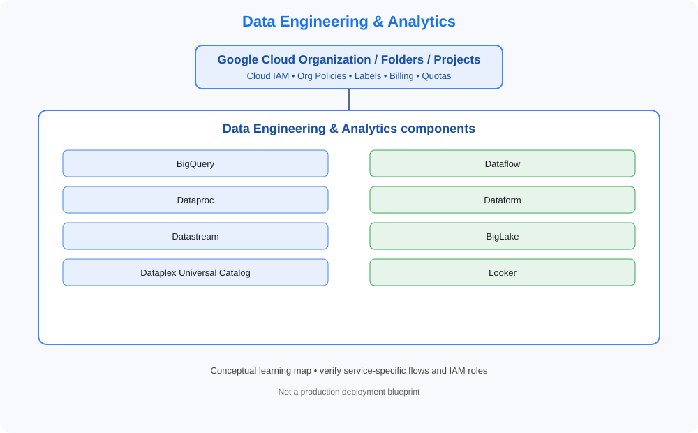

# 08. Data Engineering & Analytics

> GCP Master Vault learning tracker. This category uses GCP-native services, identity models, networking and governance terminology.

## Category architecture

- [Editable category diagram](architecture.drawio)
- [Mermaid source](architecture.mmd)
- [Visual architecture library](../../VISUAL-DIAGRAMS.md)
- [Enterprise reference architecture](../../GCP-ENTERPRISE-REFERENCE-ARCHITECTURE.md)

## Component checklist

| Topic | Learning guide | Diagram (SVG) | Editable diagram |
|---|---|---|---|
| BigQuery | [Open guide](../../services/bigquery.md) | [View](../../services/bigquery/architecture.svg) | [draw.io](../../services/bigquery/architecture.drawio) |
| Dataflow | [Open guide](../../services/dataflow.md) | [View](../../services/dataflow/architecture.svg) | [draw.io](../../services/dataflow/architecture.drawio) |
| Dataproc | [Open guide](../../services/dataproc.md) | [View](../../services/dataproc/architecture.svg) | [draw.io](../../services/dataproc/architecture.drawio) |
| Dataform | [Open guide](../../services/dataform.md) | [View](../../services/dataform/architecture.svg) | [draw.io](../../services/dataform/architecture.drawio) |
| Datastream | [Open guide](../../services/datastream.md) | [View](../../services/datastream/architecture.svg) | [draw.io](../../services/datastream/architecture.drawio) |
| BigLake | [Open guide](../../services/biglake.md) | [View](../../services/biglake/architecture.svg) | [draw.io](../../services/biglake/architecture.drawio) |
| Dataplex Universal Catalog | [Open guide](../../services/dataplex-universal-catalog.md) | [View](../../services/dataplex-universal-catalog/architecture.svg) | [draw.io](../../services/dataplex-universal-catalog/architecture.drawio) |
| Looker | [Open guide](../../services/looker.md) | [View](../../services/looker/architecture.svg) | [draw.io](../../services/looker/architecture.drawio) |

## Practice workflow
1. Read the official documentation and note service scope, limits and alternatives.
2. Map identity, network paths, data flows, dependencies and ownership.
3. Complete a sandbox lab and capture validation evidence.
4. Test an access-denied or failure scenario where safe.
5. Record monitoring, cost observations and teardown proof.

## Official references
- [GCP documentation](https://cloud.google.com/docs)
- [Architecture framework](https://cloud.google.com/architecture/framework)
- [Pricing](https://cloud.google.com/pricing/)

> Diagrams are conceptual learning resources, not production-certified designs. Verify service capabilities, IAM permissions, network behavior, quotas, regional availability and pricing before deployment.
