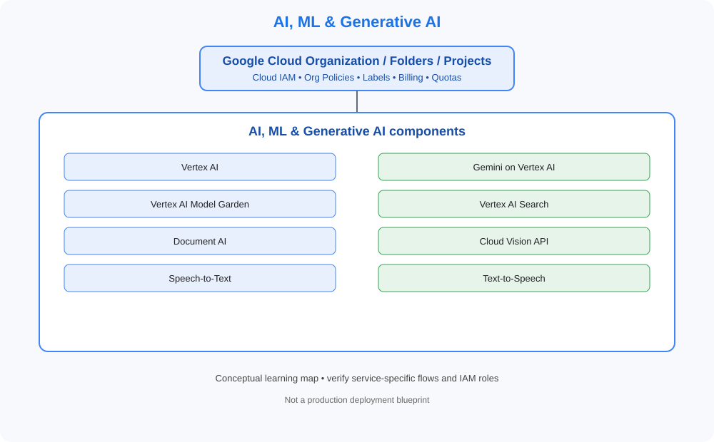

# AI, ML & Generative AI

> Category learning tracker for GCP Master Vault. Service names and examples in this folder are GCP-specific.

## Category architecture

- [Editable category diagram](architecture.drawio)
- [Mermaid source](architecture.mmd)
- [Full visual library](../../VISUAL-DIAGRAMS.md)
- [Master architecture](../../GCP-ENTERPRISE-REFERENCE-ARCHITECTURE.md)

## Component tracker

| Topic guide | SVG diagram | Editable draw.io |
|---|---|---|
| [Vertex AI](../../services/vertex-ai.md) | [SVG](../../services/vertex-ai/architecture.svg) | [draw.io](../../services/vertex-ai/architecture.drawio) |
| [Gemini on Vertex AI](../../services/gemini-on-vertex-ai.md) | [SVG](../../services/gemini-on-vertex-ai/architecture.svg) | [draw.io](../../services/gemini-on-vertex-ai/architecture.drawio) |
| [Vertex AI Model Garden](../../services/vertex-ai-model-garden.md) | [SVG](../../services/vertex-ai-model-garden/architecture.svg) | [draw.io](../../services/vertex-ai-model-garden/architecture.drawio) |
| [Vertex AI Search](../../services/vertex-ai-search.md) | [SVG](../../services/vertex-ai-search/architecture.svg) | [draw.io](../../services/vertex-ai-search/architecture.drawio) |
| [Document AI](../../services/document-ai.md) | [SVG](../../services/document-ai/architecture.svg) | [draw.io](../../services/document-ai/architecture.drawio) |
| [Cloud Vision API](../../services/cloud-vision-api.md) | [SVG](../../services/cloud-vision-api/architecture.svg) | [draw.io](../../services/cloud-vision-api/architecture.drawio) |
| [Speech-to-Text](../../services/speech-to-text.md) | [SVG](../../services/speech-to-text/architecture.svg) | [draw.io](../../services/speech-to-text/architecture.drawio) |
| [Text-to-Speech](../../services/text-to-speech.md) | [SVG](../../services/text-to-speech/architecture.svg) | [draw.io](../../services/text-to-speech/architecture.drawio) |

## Practice workflow
1. Read the official documentation for each selected service.
2. Map its account/project boundary, identity, network and data flows.
3. Complete a sandbox lab and capture validation evidence.
4. Test one denied-access or failure scenario.
5. Record cost, teardown proof and design trade-offs.

## Official references
- [Google Cloud documentation](https://cloud.google.com/docs)
- [Google Cloud Architecture Framework](https://cloud.google.com/architecture/framework)
- [Google Cloud pricing](https://cloud.google.com/pricing)

> Diagram files are conceptual learning resources, not production-certified designs. Validate current service capabilities, permissions, routing, quotas, regional availability and prices before deployment.
