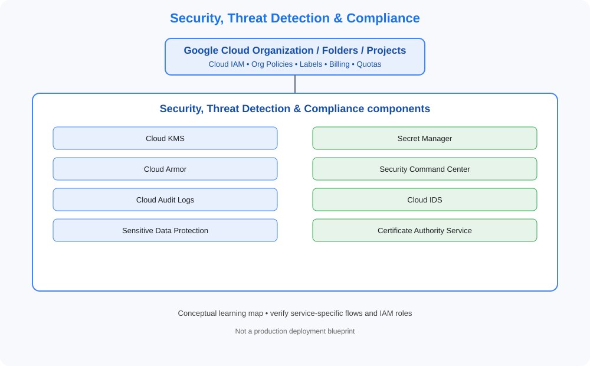

# 10. Security, Threat Detection & Compliance

> GCP Master Vault learning tracker. This category uses GCP-native services, identity models, networking and governance terminology.

## Category architecture

- [Editable category diagram](architecture.drawio)
- [Mermaid source](architecture.mmd)
- [Visual architecture library](../../VISUAL-DIAGRAMS.md)
- [Enterprise reference architecture](../../GCP-ENTERPRISE-REFERENCE-ARCHITECTURE.md)

## Component checklist

| Topic | Learning guide | Diagram (SVG) | Editable diagram |
|---|---|---|---|
| Cloud KMS | [Open guide](../../services/cloud-kms.md) | [View](../../services/cloud-kms/architecture.svg) | [draw.io](../../services/cloud-kms/architecture.drawio) |
| Secret Manager | [Open guide](../../services/secret-manager.md) | [View](../../services/secret-manager/architecture.svg) | [draw.io](../../services/secret-manager/architecture.drawio) |
| Cloud Armor | [Open guide](../../services/cloud-armor.md) | [View](../../services/cloud-armor/architecture.svg) | [draw.io](../../services/cloud-armor/architecture.drawio) |
| Security Command Center | [Open guide](../../services/security-command-center.md) | [View](../../services/security-command-center/architecture.svg) | [draw.io](../../services/security-command-center/architecture.drawio) |
| Cloud Audit Logs | [Open guide](../../services/cloud-audit-logs.md) | [View](../../services/cloud-audit-logs/architecture.svg) | [draw.io](../../services/cloud-audit-logs/architecture.drawio) |
| Cloud IDS | [Open guide](../../services/cloud-ids.md) | [View](../../services/cloud-ids/architecture.svg) | [draw.io](../../services/cloud-ids/architecture.drawio) |
| Sensitive Data Protection | [Open guide](../../services/sensitive-data-protection.md) | [View](../../services/sensitive-data-protection/architecture.svg) | [draw.io](../../services/sensitive-data-protection/architecture.drawio) |
| Certificate Authority Service | [Open guide](../../services/certificate-authority-service.md) | [View](../../services/certificate-authority-service/architecture.svg) | [draw.io](../../services/certificate-authority-service/architecture.drawio) |

## Practice workflow
1. Read the official documentation and note service scope, limits and alternatives.
2. Map identity, network paths, data flows, dependencies and ownership.
3. Complete a sandbox lab and capture validation evidence.
4. Test an access-denied or failure scenario where safe.
5. Record monitoring, cost observations and teardown proof.

## Official references
- [GCP documentation](https://cloud.google.com/docs)
- [Architecture framework](https://cloud.google.com/architecture/framework)
- [Pricing](https://cloud.google.com/pricing/)

> Diagrams are conceptual learning resources, not production-certified designs. Verify service capabilities, IAM permissions, network behavior, quotas, regional availability and pricing before deployment.
