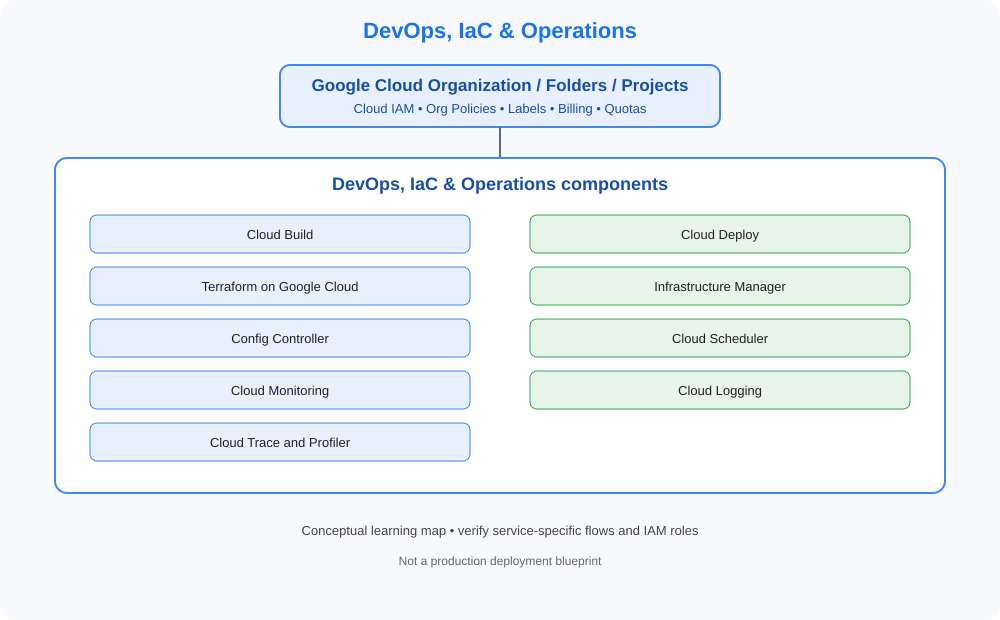

# 11. DevOps, IaC & Operations

> GCP Master Vault learning tracker. This category uses GCP-native services, identity models, networking and governance terminology.

## Category architecture

- [Editable category diagram](architecture.drawio)
- [Mermaid source](architecture.mmd)
- [Visual architecture library](../../VISUAL-DIAGRAMS.md)
- [Enterprise reference architecture](../../GCP-ENTERPRISE-REFERENCE-ARCHITECTURE.md)

## Component checklist

| Topic | Learning guide | Diagram (SVG) | Editable diagram |
|---|---|---|---|
| Cloud Build | [Open guide](../../services/cloud-build.md) | [View](../../services/cloud-build/architecture.svg) | [draw.io](../../services/cloud-build/architecture.drawio) |
| Cloud Deploy | [Open guide](../../services/cloud-deploy.md) | [View](../../services/cloud-deploy/architecture.svg) | [draw.io](../../services/cloud-deploy/architecture.drawio) |
| Terraform on Google Cloud | [Open guide](../../services/terraform-on-google-cloud.md) | [View](../../services/terraform-on-google-cloud/architecture.svg) | [draw.io](../../services/terraform-on-google-cloud/architecture.drawio) |
| Infrastructure Manager | [Open guide](../../services/infrastructure-manager.md) | [View](../../services/infrastructure-manager/architecture.svg) | [draw.io](../../services/infrastructure-manager/architecture.drawio) |
| Config Controller | [Open guide](../../services/config-controller.md) | [View](../../services/config-controller/architecture.svg) | [draw.io](../../services/config-controller/architecture.drawio) |
| Cloud Scheduler | [Open guide](../../services/cloud-scheduler.md) | [View](../../services/cloud-scheduler/architecture.svg) | [draw.io](../../services/cloud-scheduler/architecture.drawio) |
| Cloud Monitoring | [Open guide](../../services/cloud-monitoring.md) | [View](../../services/cloud-monitoring/architecture.svg) | [draw.io](../../services/cloud-monitoring/architecture.drawio) |
| Cloud Logging | [Open guide](../../services/cloud-logging.md) | [View](../../services/cloud-logging/architecture.svg) | [draw.io](../../services/cloud-logging/architecture.drawio) |
| Cloud Trace and Profiler | [Open guide](../../services/cloud-trace-and-profiler.md) | [View](../../services/cloud-trace-and-profiler/architecture.svg) | [draw.io](../../services/cloud-trace-and-profiler/architecture.drawio) |

## Practice workflow
1. Read the official documentation and note service scope, limits and alternatives.
2. Map identity, network paths, data flows, dependencies and ownership.
3. Complete a sandbox lab and capture validation evidence.
4. Test an access-denied or failure scenario where safe.
5. Record monitoring, cost observations and teardown proof.

## Official references
- [GCP documentation](https://cloud.google.com/docs)
- [Architecture framework](https://cloud.google.com/architecture/framework)
- [Pricing](https://cloud.google.com/pricing/)

> Diagrams are conceptual learning resources, not production-certified designs. Verify service capabilities, IAM permissions, network behavior, quotas, regional availability and pricing before deployment.
