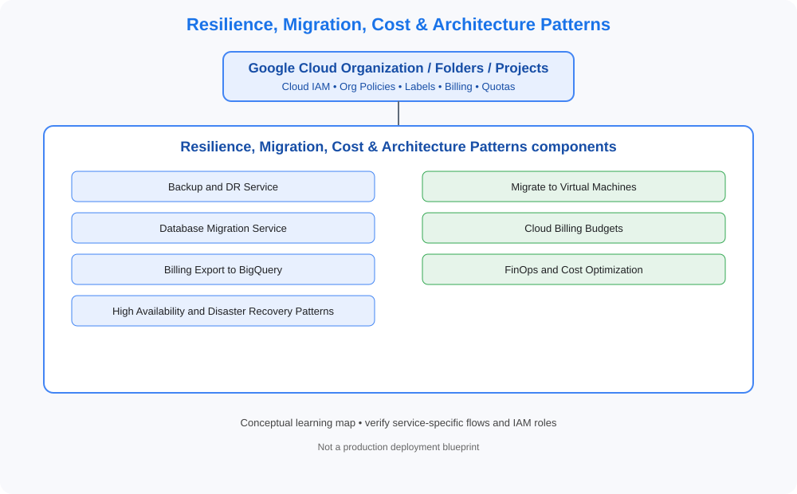

# Resilience, Migration, Cost & Architecture Patterns

> Category learning tracker for GCP Master Vault. Service names and examples in this folder are GCP-specific.

## Category architecture

- [Editable category diagram](architecture.drawio)
- [Mermaid source](architecture.mmd)
- [Full visual library](../../VISUAL-DIAGRAMS.md)
- [Master architecture](../../GCP-ENTERPRISE-REFERENCE-ARCHITECTURE.md)

## Component tracker

| Topic guide | SVG diagram | Editable draw.io |
|---|---|---|
| [Backup and DR Service](../../services/backup-and-dr-service.md) | [SVG](../../services/backup-and-dr-service/architecture.svg) | [draw.io](../../services/backup-and-dr-service/architecture.drawio) |
| [Migrate to Virtual Machines](../../services/migrate-to-virtual-machines.md) | [SVG](../../services/migrate-to-virtual-machines/architecture.svg) | [draw.io](../../services/migrate-to-virtual-machines/architecture.drawio) |
| [Database Migration Service](../../services/database-migration-service.md) | [SVG](../../services/database-migration-service/architecture.svg) | [draw.io](../../services/database-migration-service/architecture.drawio) |
| [Cloud Billing Budgets](../../services/cloud-billing-budgets.md) | [SVG](../../services/cloud-billing-budgets/architecture.svg) | [draw.io](../../services/cloud-billing-budgets/architecture.drawio) |
| [Billing Export to BigQuery](../../services/billing-export-to-bigquery.md) | [SVG](../../services/billing-export-to-bigquery/architecture.svg) | [draw.io](../../services/billing-export-to-bigquery/architecture.drawio) |
| [FinOps and Cost Optimization](../../services/finops-and-cost-optimization.md) | [SVG](../../services/finops-and-cost-optimization/architecture.svg) | [draw.io](../../services/finops-and-cost-optimization/architecture.drawio) |
| [High Availability and Disaster Recovery Patterns](../../services/high-availability-and-disaster-recovery-patterns.md) | [SVG](../../services/high-availability-and-disaster-recovery-patterns/architecture.svg) | [draw.io](../../services/high-availability-and-disaster-recovery-patterns/architecture.drawio) |

## Practice workflow
1. Read the official documentation for each selected service.
2. Map its account/project boundary, identity, network and data flows.
3. Complete a sandbox lab and capture validation evidence.
4. Test one denied-access or failure scenario.
5. Record cost, teardown proof and design trade-offs.

## Official references
- [Google Cloud documentation](https://cloud.google.com/docs)
- [Google Cloud Architecture Framework](https://cloud.google.com/architecture/framework)
- [Google Cloud pricing](https://cloud.google.com/pricing)

> Diagram files are conceptual learning resources, not production-certified designs. Validate current service capabilities, permissions, routing, quotas, regional availability and prices before deployment.
