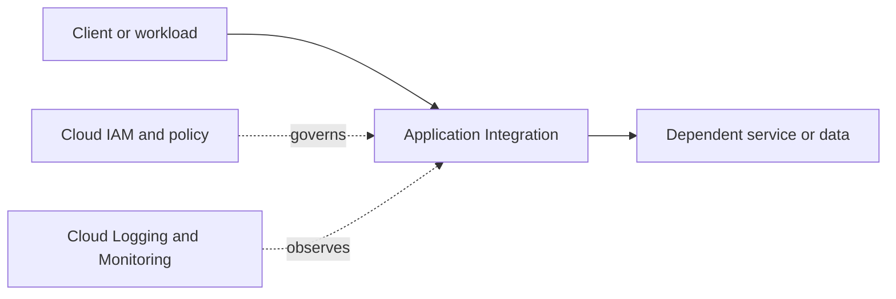

# Application Integration

> Category: [07. serverless integration](../buckets/07-serverless-integration/README.md)

## Purpose and architecture placement
Use the [official Google Cloud documentation](https://cloud.google.com/docs) to verify the current purpose, capabilities, service limits and alternatives for Application Integration. Map its caller, downstream dependencies, project/network boundaries, identity, data flows and operational ownership before implementation.



Conceptual learning diagram; replace it with verified service-specific flows for a real workload.

## Design checklist
- [ ] State business purpose, workload profile, security constraints and SLOs.
- [ ] Choose location and availability model.
- [ ] Define project boundaries, owners, labels and quota requirements.
- [ ] Document ingress/egress, DNS, private access and dependencies where applicable.
- [ ] Define least-privilege IAM roles and workload identities.
- [ ] Classify data; select encryption, retention and access controls.
- [ ] Define dashboards, actionable alerts, logs and runbooks.
- [ ] Estimate cost drivers and assign an owner.
- [ ] Plan failure handling and backup/recovery where relevant.

## Security, networking and operations
Prefer least privilege and short-lived identities. Avoid long-lived service-account keys when a suitable workload identity approach exists. Document public/private endpoints, egress, DNS, audit needs, data protection, quotas, scaling, dependency failure modes, observability and support ownership. Confirm actual roles and controls in product documentation.

## Infrastructure as Code
Use Terraform or an approved Google Cloud infrastructure workflow. Protect state, pin provider versions, review plans and do not commit secrets. Confirm service-specific resource types and arguments before applying. The generic provider scaffold below is not a complete service deployment.

```hcl
terraform {
  required_providers {
    google = {
      source  = "hashicorp/google"
      version = ">= 5.0"
    }
  }
}
provider "google" {
  project = var.project_id
  region  = var.region
}
variable "project_id" { type = string }
variable "region" { type = string }
```

## Hands-on lab
1. Read the official service overview and quickstart.
2. Deploy a minimal example in a dedicated sandbox project.
3. Validate expected behavior, permissions, connectivity, logs and metrics.
4. Test one failure or access-denial scenario.
5. Review charges, delete lab resources and verify cleanup.

## Alternatives and interview practice
Compare options by latency, scale, availability, consistency, control, portability, compliance, operations burden and total cost.
1. What problem does Application Integration solve, and when is it appropriate?
2. What identity and security controls matter?
3. How does it interact with network and dependent services?
4. What scaling, quota or failure risks should be considered?
5. How would you monitor, troubleshoot and optimize it?
6. When would an alternative be preferable?

## Official references
- [Google Cloud documentation](https://cloud.google.com/docs)
- [Google Cloud Architecture Framework](https://cloud.google.com/architecture/framework)
- [Google Cloud pricing](https://cloud.google.com/pricing)
- [Terraform Google provider](https://registry.terraform.io/providers/hashicorp/google/latest/docs)

> Validation status: standardized learning scaffold. Service-specific settings, IAM roles, quotas, provider syntax and prices are not individually production-validated. Verify before use.
