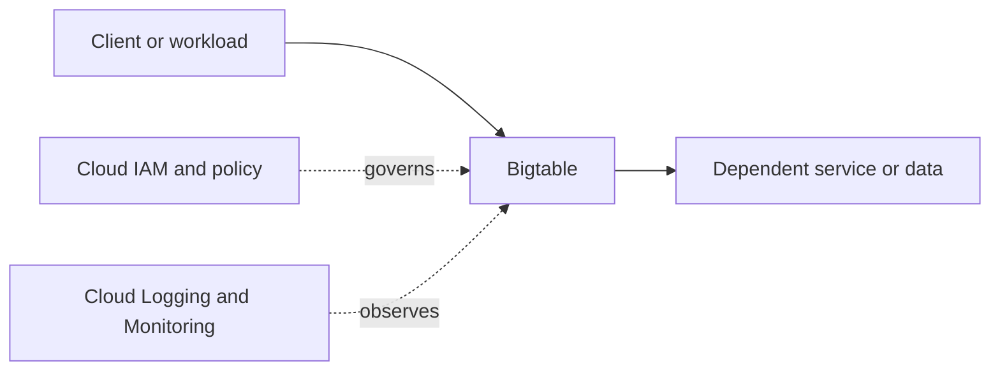

# Bigtable

## Purpose and fit
Use the [official Google Cloud documentation](https://cloud.google.com/docs) to confirm the current capabilities, selection criteria, regional availability, pricing and limits for Bigtable. Design from workload requirements rather than choosing a service first.

## Architecture placement
Document the caller, data flows, project and network boundaries, workload identity, downstream dependencies and operational owner.



Conceptual starter diagram only; replace with verified service-specific flows for a real workload.

## Design checklist
- [ ] Define use case, non-functional requirements and SLOs.
- [ ] Select region/location and availability design.
- [ ] Define project boundaries, owners, labels, quotas and naming.
- [ ] Document ingress/egress, DNS and private connectivity where relevant.
- [ ] Define least-privilege IAM roles and workload identities.
- [ ] Classify data; choose encryption, retention and access controls.
- [ ] Define logs, metrics, actionable alerts, runbooks and support ownership.
- [ ] Estimate cost drivers and assign an owner.
- [ ] Plan failure handling, backup/restore and recovery where applicable.

## Security and operations
Prefer least privilege and short-lived identities; avoid long-lived service-account keys where workload identity federation is appropriate. Validate actual IAM roles, API enablement, network requirements, data protection, quotas, logging and service-specific operational controls against current official documentation.

## Infrastructure as Code
Use Terraform or an approved infrastructure management workflow. Protect state, pin provider versions, review plans and never store secrets in source control. Select resource types and arguments from the current provider documentation.

```hcl
terraform {
  required_providers {
    google = {
      source = "hashicorp/google"
    }
  }
}
provider "google" {
  project = var.project_id
  region  = var.region
}
variable "project_id" { type = string }
variable "region" { type = string }
```

This generic scaffold is not a complete deployable configuration for Bigtable.

## Hands-on lab
1. Read the official product overview and quickstart.
2. Deploy a minimal example in a dedicated sandbox project.
3. Validate behavior, access controls, connectivity, logs and metrics.
4. Test one failure or access-denial case.
5. Review charges, remove lab resources and verify cleanup.

## Alternatives and interview practice
Compare options by workload fit, latency, scale, availability, consistency, control, compliance, operations burden and total cost.
1. What problem does Bigtable solve?
2. Which identity and security decisions matter?
3. What are the main dependencies and network considerations?
4. What failure modes, quota limits and scaling risks should be considered?
5. How would you monitor, troubleshoot and optimize it?
6. When would an alternative be preferable?

## Official references
- [Google Cloud documentation](https://cloud.google.com/docs)
- [Google Cloud Architecture Framework](https://cloud.google.com/architecture/framework)
- [Google Cloud pricing](https://cloud.google.com/pricing)
- [Terraform Google provider](https://registry.terraform.io/providers/hashicorp/google/latest/docs)

> **Validation status:** Standardized learning scaffold. Service-specific settings, IAM roles, quotas, provider syntax and prices are not individually production-validated; verify before use.
