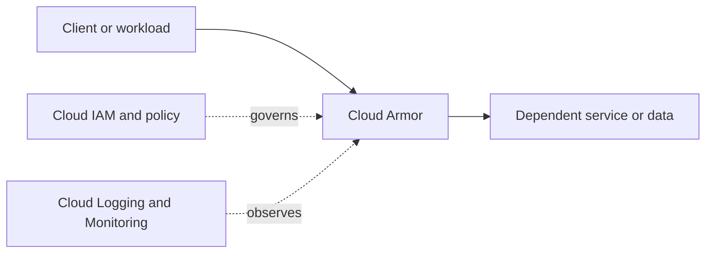

# Cloud Armor

## Purpose and fit
Use the [official Google Cloud documentation](https://cloud.google.com/docs) to verify current capabilities, selection criteria, pricing, availability and limits for Cloud Armor. Start from the workload requirements, not from the service name.

## Architecture placement
Document the caller, data flow, project and network boundaries, workload identity, downstream dependencies, and operational owner.



This is a conceptual learning diagram, not a verified deployment blueprint.

## Design checklist
- [ ] Define the business use case, non-functional requirements and SLOs.
- [ ] Select region/location and availability design.
- [ ] Define project boundaries, ownership, labels, quotas and naming.
- [ ] Document ingress/egress, DNS and private connectivity where relevant.
- [ ] Define least-privilege IAM and workload identity.
- [ ] Classify data and specify encryption, retention and access control.
- [ ] Configure observability, alerts, runbooks and on-call ownership.
- [ ] Estimate cost drivers and establish budgets/alerts.
- [ ] Plan failure handling, backup/restore and recovery objectives when applicable.

## Security and operations
Prefer least privilege and short-lived identities; avoid long-lived service-account keys where workload identity federation is appropriate. Validate actual IAM roles, API enablement, network requirements, data-protection settings, quotas, logging, and service-specific operational controls against current official docs.

## Infrastructure as Code
Use Terraform or an approved infrastructure management workflow. Protect state, pin provider versions, review plans, and do not store secrets in source control. Resource types and arguments must be selected from the current provider documentation.

```hcl
terraform {
  required_providers {
    google = {
      source = "hashicorp/google"
    }
  }
}
provider "google" {
  project = var.project_id
  region  = var.region
}
variable "project_id" { type = string }
variable "region" { type = string }
```

This is only a provider scaffold, not a deployable configuration for Cloud Armor.

## Hands-on lab
1. Read the official service overview and quickstart.
2. Create a minimal example in a dedicated sandbox project.
3. Validate expected behavior, access controls, connectivity, logs and metrics.
4. Test one failure or access-denial case.
5. Review charges and remove the lab resources; verify cleanup.

## Alternatives and interview practice
Compare alternatives using workload fit, latency, scale, availability, control, consistency, compliance, operational burden and total cost.
1. What problem does Cloud Armor solve?
2. What identity and security decisions matter?
3. What are the main dependencies and network considerations?
4. What are likely failure modes, quota limits and scaling risks?
5. How would you monitor, troubleshoot and optimize it?
6. When would you choose an alternative?

## Official references
- [Google Cloud documentation](https://cloud.google.com/docs)
- [Google Cloud Architecture Framework](https://cloud.google.com/architecture/framework)
- [Google Cloud pricing](https://cloud.google.com/pricing)
- [Terraform Google provider](https://registry.terraform.io/providers/hashicorp/google/latest/docs)

> **Validation status:** Standardized learning scaffold. Service-specific settings, IAM roles, quotas, provider syntax and prices are not individually production-validated; verify before use.
