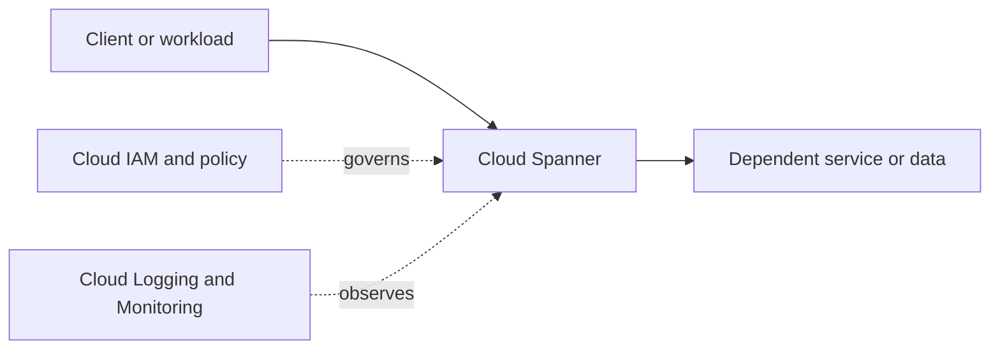

# Cloud Spanner

**Learning category:** [Storage, Databases & Caching](../buckets/06-storage-databases/README.md)

## Purpose and fit
Review the [official Google Cloud documentation](https://cloud.google.com/docs) for the current purpose, capabilities, operational model, pricing and product limits for Cloud Spanner. Choose services based on workload requirements, not familiarity alone.

## Architecture placement
Document callers, data flows, downstream dependencies, project boundaries, network paths, workload identity, trust boundaries and operational owner.



Conceptual diagram; verify and replace with a workload-specific design before production use.

## Design checklist
- [ ] Capture use case, non-functional requirements, SLO and threat model.
- [ ] Choose location, availability pattern and recovery objectives.
- [ ] Define project boundary, ownership, labels and quota requirements.
- [ ] Document ingress/egress, DNS, private access and service dependencies where relevant.
- [ ] Apply least-privilege IAM and workload identities.
- [ ] Classify data; define encryption, retention and access controls.
- [ ] Define logs, metrics, alerts, dashboards and runbooks.
- [ ] Estimate cost drivers and establish budget monitoring.
- [ ] Plan failure tests, backup/restore and cleanup as applicable.

## Security, networking and operations
Prefer least privilege and short-lived identities; avoid long-lived service-account keys where workload identity federation is suitable. Validate required roles, API enablement, network and DNS needs, audit logging, data-protection settings, quotas, scaling behavior and service-specific security controls in official docs.

## Infrastructure as Code
Use Terraform or an approved Google Cloud infrastructure workflow. Protect state, pin provider versions, review plans and keep secrets out of source control. Confirm service-specific resources and arguments before applying.

```hcl
terraform {
  required_providers {
    google = {
      source = "hashicorp/google"
    }
  }
}
provider "google" {
  project = var.project_id
  region  = var.region
}
variable "project_id" { type = string }
variable "region" { type = string }
```

This generic provider scaffold is not a complete deployable configuration for Cloud Spanner.

## Hands-on lab
1. Read the official overview and quickstart.
2. Deploy a minimum viable example in a dedicated sandbox project.
3. Validate behavior, access controls, connectivity, logs and metrics.
4. Test a failure or denied-access scenario.
5. Review charges, remove test resources and verify cleanup.

## Alternatives and interview practice
Compare alternatives by fit, latency, scale, availability, consistency, compliance, control, operating burden and total cost.
1. What problem does Cloud Spanner solve, and when is it appropriate?
2. Which identity and security decisions matter?
3. What network and dependency assumptions must be documented?
4. What quota, scaling and failure risks should be considered?
5. How would you monitor, troubleshoot and optimize it?
6. When would an alternative be preferable?

## Official references
- [Google Cloud documentation](https://cloud.google.com/docs)
- [Google Cloud Architecture Framework](https://cloud.google.com/architecture/framework)
- [Google Cloud pricing](https://cloud.google.com/pricing)
- [Terraform Google provider](https://registry.terraform.io/providers/hashicorp/google/latest/docs)

> **Validation status:** Standardized learning scaffold. Service-specific settings, IAM roles, quotas, Terraform arguments and current pricing are not individually production-validated; verify before implementation.
