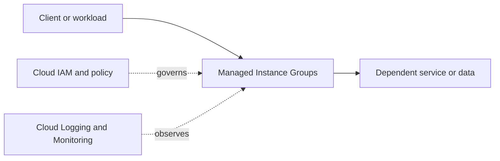

# Managed Instance Groups

## Purpose and design fit
Use the official [Google Cloud documentation](https://cloud.google.com/docs) to learn supported capabilities, operational model, limits and alternatives for Managed Instance Groups.

## Architecture placement
Map the caller, this service, downstream dependencies, project/network boundaries, identity and observable signals before implementing a design.



Conceptual diagram only; replace with service-specific resources and verified flows for a real workload.

## Design checklist
- [ ] Write workload purpose, requirements and SLOs.
- [ ] Choose location and availability approach.
- [ ] Define project ownership, labels and quotas.
- [ ] Map ingress/egress, DNS, private access and dependencies where applicable.
- [ ] Apply least-privilege IAM and appropriate workload identities.
- [ ] Classify data; define encryption, retention and access.
- [ ] Define metrics, logs, alerts, runbooks and support ownership.
- [ ] Estimate cost drivers and set budgets/alerts.
- [ ] Plan failure handling, backup and recovery where applicable.

## Security, network and operations
Prefer least privilege and short-lived identities. Avoid long-lived service-account keys where workload identity federation is suitable. Document public/private endpoints, egress, access controls, data protection, quotas, dependency failure modes, scaling, observability and operational ownership. Validate the actual roles and controls in official docs.

## Infrastructure as Code
Use Terraform or an approved infrastructure workflow. Protect state, pin provider versions, review plans and do not commit secrets. Confirm service-specific resource types and arguments before applying.

Generic provider scaffold (not a complete deployable resource):
```hcl
terraform {
  required_providers {
    google = {
      source  = "hashicorp/google"
      version = ">= 5.0"
    }
  }
}
provider "google" {
  project = var.project_id
  region  = var.region
}
variable "project_id" { type = string }
variable "region" { type = string }
```

## Hands-on lab
1. Read the product overview and quickstart.
2. Deploy a minimal sandbox example.
3. Validate behavior, permissions, connectivity, logs and metrics.
4. Test one failure or access-denial scenario.
5. Review charges, delete lab resources and verify cleanup.

## Alternatives and interview practice
Compare choices by latency, consistency, scale, control, portability, compliance, operational effort and total cost.
1. What does Managed Instance Groups solve and when is it appropriate?
2. Which identity and security controls matter?
3. How does it interact with network and dependent services?
4. What failure, scaling and quota risks should be considered?
5. How would you monitor and optimize it?
6. When would an alternative be preferable?

## Official references
- [Google Cloud documentation](https://cloud.google.com/docs)
- [Architecture Framework](https://cloud.google.com/architecture/framework)
- [Pricing](https://cloud.google.com/pricing)
- [Terraform Google provider](https://registry.terraform.io/providers/hashicorp/google/latest/docs)

> Learning scaffold: service-specific settings, roles, quotas, provider syntax and prices are not individually production-validated. Verify before use.
