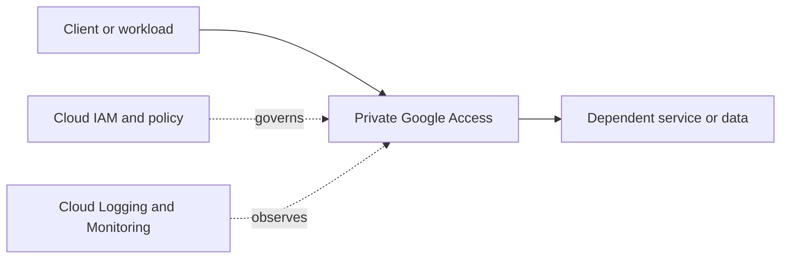

# Private Google Access

> Category: [Networking & Connectivity](../buckets/03-networking/README.md)

## Purpose and fit
Understand the problem this service solves, its operational model, key capabilities and selection criteria. Begin with the [official Google Cloud documentation](https://cloud.google.com/docs).

## Architecture placement
Map the service's project and network boundaries, upstream callers, downstream dependencies, trust boundaries, data flows and operational owner.



This is a conceptual starter diagram, not a validated deployment design.

## Design checklist
- [ ] Identify business purpose, workload profile and non-functional requirements.
- [ ] Choose region/location scope and availability model.
- [ ] Define projects, ownership, labels, quotas and naming.
- [ ] Document ingress/egress, DNS, private connectivity and dependencies where applicable.
- [ ] Define least-privilege IAM roles, service identities and audit needs.
- [ ] Classify data and choose encryption, retention and access controls.
- [ ] Define SLOs, health signals, alerts, dashboards and runbooks.
- [ ] Estimate cost drivers and assign an owner.
- [ ] Plan failure handling, backups and recovery objectives where relevant.

## Security and identity
Prefer least privilege and short-lived identities; avoid downloaded service-account keys when workload identity federation is suitable. Separate human and workload access, review inherited permissions, and validate the service's required roles against current documentation.

## Networking and data protection
Decide whether the service needs a public endpoint, private access, VPC controls, firewall rules, Private Service Connect, egress restrictions or DNS integration. Align encryption, key management, data residency, retention and recovery with data classification.

## Reliability and operations
Document scaling and quota limits, dependency failure modes, maintenance, backup/restore, logs, metrics, alert thresholds and ownership. Exercise failure and recovery paths rather than assuming configured controls work.

## Infrastructure as Code
Use Terraform or an approved Google Cloud infrastructure workflow where appropriate. Protect state, pin provider versions, review plans and keep secrets out of source control. Verify service-specific resource types and arguments before applying.

Generic Terraform provider scaffold (not a complete service deployment):

```hcl
terraform {
  required_providers {
    google = {
      source  = "hashicorp/google"
      version = ">= 5.0"
    }
  }
}

provider "google" {
  project = var.project_id
  region  = var.region
}

variable "project_id" {
  type        = string
  description = "Existing Google Cloud project ID"
}

variable "region" {
  type        = string
  description = "Deployment region"
}
```

## Hands-on learning lab
1. Read the service overview and quickstart.
2. Create a minimal non-production example in a sandbox project.
3. Validate expected behavior, permissions, network connectivity and observability.
4. Test one failure or access-denial case.
5. Review charges, delete lab resources and verify cleanup.

## Alternatives and trade-offs
Compare managed and self-managed alternatives by scale, latency, availability, consistency, control, portability, operational burden, compliance and total cost. Document why this option meets the specific requirements.

## Interview practice
1. What problem does Private Google Access solve, and when is it a good fit?
2. What identity and security decisions matter most?
3. How does it connect safely to other services?
4. What scaling, quota and failure risks should be considered?
5. How would you observe, troubleshoot and optimize it?
6. When would you select an alternative?

## Official references
- [Google Cloud documentation](https://cloud.google.com/docs)
- [Google Cloud Architecture Framework](https://cloud.google.com/architecture/framework)
- [Google Cloud pricing](https://cloud.google.com/pricing)
- [Terraform Google provider](https://registry.terraform.io/providers/hashicorp/google/latest/docs)

> **Validation status:** Standardized learning scaffold. Service-specific features, IAM roles, quotas, Terraform resources and prices are not individually production-validated here. Verify before use.
